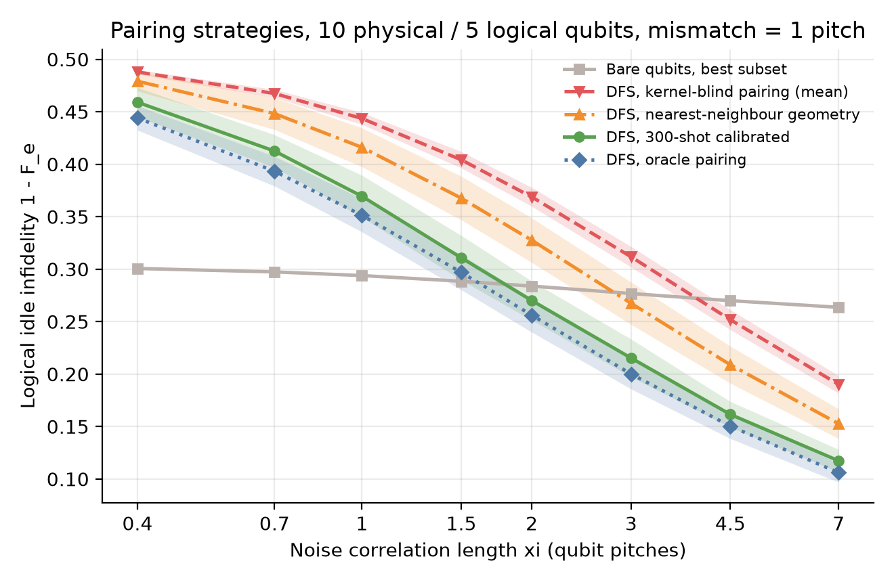
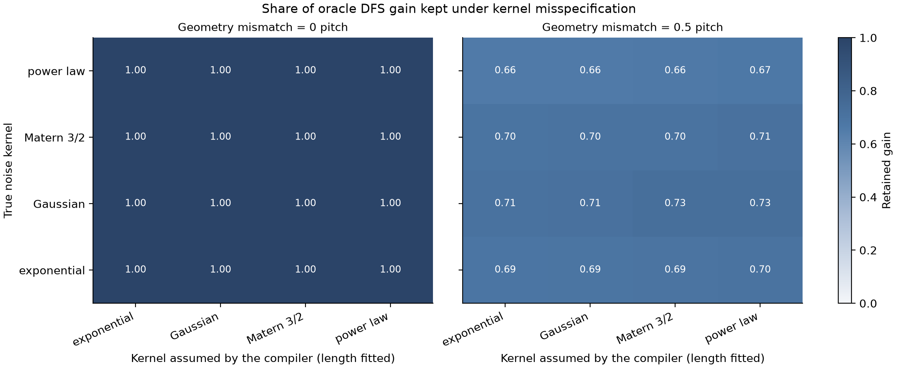
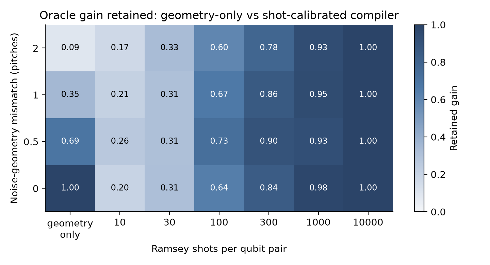
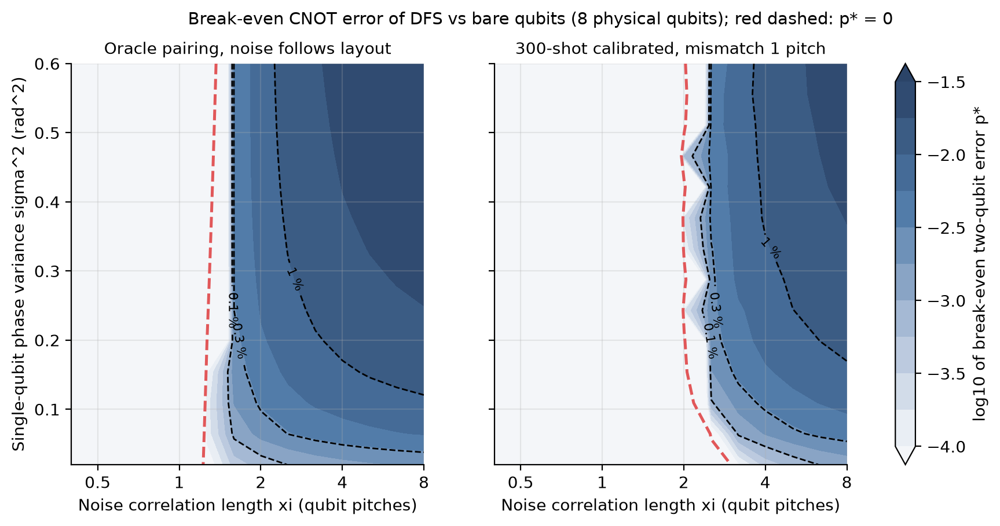
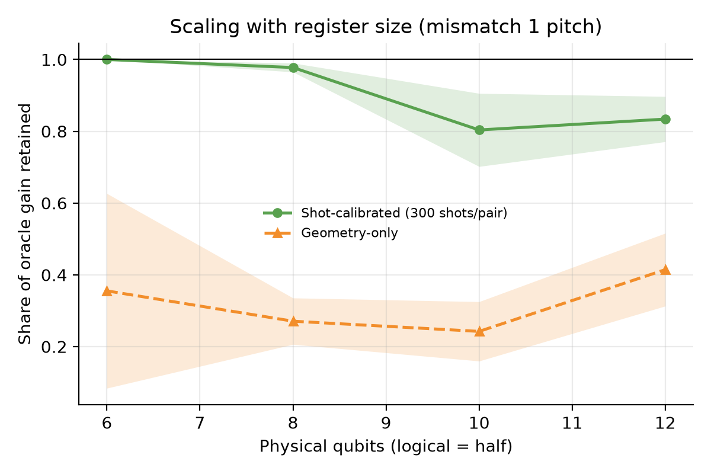

# Kernel-aware decoherence-free pairing under correlated dephasing

[](LICENSE)
[](pyproject.toml)
[](https://github.com/pradeepdegalaroyal/kernel-aware-dfs-pairing-correlated-dephasing/actions/workflows/ci.yml)

**Abstract.** When dephasing noise is correlated across a chip, a logical qubit built from two physical qubits that see a
common phase (a decoherence-free subspace, DFS) can beat unencoded qubits, but only if the compiler pairs the right
qubits. I solve the pairing exactly (all 105 to 10 395 pairings) with a closed-form logical fidelity and ask what the compiler
must know: the kernel shape, the noise geometry, or measured pair correlations. In simulation (6-12 physical qubits) the
kernel shape does not matter, a wrong noise geometry does, and about 300 Ramsey shots per pair recover most of the
oracle gain.

## The problem

A superconducting-style register idles while other operations run. Its qubits pick up random phases that are
correlated through shared environments. Two physical qubits that share most of their phase noise can be paired into one
logical qubit that is immune to the shared part. Which pairs to form is a compile-time decision, and it needs a model of
who is correlated with whom.

## Why existing models fall short

* Abdel-Aty et al., 2027 (Digital Object Identifier, DOI, 10.1016/j.asej.2026.104502) give a correlated-dephasing template with exponential, Gaussian,
  Matérn and power-law kernels and a Greenberger-Horne-Zeilinger (GHZ) circuit test, and state that mitigation and
  compilation claims are kept cautious. They do not turn the kernel into a compile decision.
* Tariq and Chatzinotas, 2026 (DOI 10.1038/s41534-026-01308-w) tune quantum multiple-input multiple-output (QuMIMO) diversity
  coding with channel state information (CSI), and McClean et al., 2016 (DOI 10.1088/1367-2630/18/2/023023) argue for noise-aware design.
  Neither prices the measurements needed to learn the correlations.
* Adjacent communications work models correlated antenna ports with a copula and tests aged CSI (Yahya et al., 2027,
  DOI 10.1016/j.aeue.2026.156647); it is the closest statistical analogue but has no quantum fidelity or shot budget.

The full table of 12 papers is in [`docs/RESEARCH_GAP.md`](docs/RESEARCH_GAP.md).

## What is new here

* The correlated-dephasing kernel template becomes an **exactly solved compile decision**: the logical idle fidelity
  has a closed form, so the optimal pairing is found by enumeration rather than a heuristic.
* A **kernel-shape versus geometry versus data** decomposition: shape (16 true/assumed kernel pairs), geometry
  mismatch (0-2 qubit pitches) and calibration shots (10-10 000 per pair) are swept on the same instances.
* A **calibration-cost number** and a **break-even two-qubit error** map that say when the DFS encoding overhead pays.

## Method

```mermaid
%%{init: {'theme': 'base', 'themeVariables': {'primaryColor': '#ffffff', 'primaryTextColor': '#000000', 'primaryBorderColor': '#000000', 'lineColor': '#000000', 'secondaryColor': '#ffffff', 'tertiaryColor': '#ffffff', 'background': '#ffffff', 'noteBkgColor': '#ffffff', 'noteTextColor': '#000000', 'actorBkg': '#ffffff', 'actorBorder': '#000000', 'actorTextColor': '#000000', 'signalColor': '#000000', 'signalTextColor': '#000000', 'labelBoxBkgColor': '#ffffff', 'labelTextColor': '#000000', 'clusterBkg': '#ffffff', 'clusterBorder': '#000000'}}}%%
flowchart TD
  subgraph IN["Inputs"]
    A["layouts.py<br/>jittered chip grid, 6 to 12 qubits"]
    B["kernels.py<br/>4 kernels, length xi, variance sigma2<br/>plus geometry mismatch"]
  end
  subgraph COMP["Calibrate and compile"]
    C["calibration.py<br/>Ramsey shots per qubit pair"]
    D["Compiler beliefs<br/>geometry only, fitted kernel,<br/>shot estimate, oracle"]
    E["compile.py<br/>enumerate every pairing<br/>pick the best under the belief"]
  end
  subgraph EVAL["Evaluation"]
    F["channel.py<br/>exact logical fidelity F_e<br/>under the true noise"]
    G["validation.py<br/>sampled phases and<br/>Qiskit encoder check"]
    H["studies.py and control.py<br/>experiments E1 to E6, CPMG baseline<br/>to results csv and figures png"]
  end
  A --> C
  B --> C
  C --> D
  D --> E
  E --> F
  B --> F
  G --> F
  F --> H
  classDef bw fill:#ffffff,stroke:#000000,color:#000000,stroke-width:2px;
  class A,B,C,D,E,F,G,H bw;
```

Legend: CPMG = Carr-Purcell-Meiboom-Gill dynamical-decoupling sequence; Ramsey = phase-sensitive two-pulse experiment;
`F_e` = entanglement fidelity of the idle channel with the identity.

**Summary.** Each physical qubit gets a Gaussian phase with covariance `sigma2 * rho(distance)`. A logical qubit is
either an unencoded qubit or a pair `|0_L> = |01>`, `|1_L> = |10>`. The logical idle fidelity is exactly
`F_e = E_t exp(-t^T M t / 2)` over `t` in {0, +1, -1}^L, with `M` the covariance seen by the logical qubits. A compiler
picks the pairing that maximises `F_e` under *its belief* about the covariance; the pick is scored under the true one.
Baselines: unencoded qubits with the best subset chosen using the true covariance (strong), kernel-blind pairing,
nearest-neighbour geometry pairing, and the standard control baseline, dynamical decoupling (DD) with CPMG pulses.
Full detail: [`docs/METHOD.md`](docs/METHOD.md).

## Results

All numbers are mean ± standard deviation over 5 seeds (each seed = 8 random chip layouts) from `results/`.
Infidelity `1 - F_e` at 10 physical (5 logical) qubits, single-qubit phase variance 0.3 rad², noise geometry displaced
by 1 qubit pitch from the layout (`results/e1_strategies_vs_xi.csv`):

| Correlation length xi (pitches) | Bare, best subset | DFS kernel-blind | DFS geometry only | DFS 300-shot calibrated | DFS oracle |
|---|---|---|---|---|---|
| 1.0 | 0.294 ± 0.001 | 0.444 ± 0.006 | 0.416 ± 0.019 | 0.369 ± 0.020 | 0.351 ± 0.016 |
| 2.0 | 0.284 ± 0.001 | 0.369 ± 0.009 | 0.328 ± 0.021 | 0.270 ± 0.019 | 0.256 ± 0.016 |
| 4.5 | 0.270 ± 0.001 | 0.252 ± 0.010 | 0.209 ± 0.018 | 0.162 ± 0.012 | 0.150 ± 0.012 |



*Takeaway: with a displaced noise geometry, the geometry-only DFS stays worse than unencoded qubits until xi is about 3 pitches, while the 300-shot calibrated DFS already wins at xi = 2.* (The same plot with noise following the layout is `figures/fig1_strategies_vs_xi.png`.)

**Kernel shape (hypothesis H1).** When noise follows the layout, all 16 (true kernel, assumed kernel) combinations retain
at least 0.995 of the oracle gain (`results/e2_kernel_shape.csv`). With a 0.5-pitch displacement every entry drops to
between 0.657 and 0.730 *regardless of the assumed kernel*.



*Takeaway: the kernel family is not what limits the compiler; the geometry is.*

**Calibration cost (hypothesis H2).** Retained gain of the compilers (`results/e3_calibration.csv`):

| Geometry mismatch (pitches) | Geometry only | Exponential fit | 100 shots / pair | 300 shots / pair | 1000 shots / pair |
|---|---|---|---|---|---|
| 0 | 0.999 ± 0.002 | 1.000 ± 0.000 | 0.640 ± 0.037 | 0.843 ± 0.102 | 0.976 ± 0.027 |
| 1 | 0.350 ± 0.097 | 0.379 ± 0.140 | 0.667 ± 0.115 | 0.858 ± 0.108 | 0.947 ± 0.012 |
| 2 | 0.091 ± 0.079 | 0.099 ± 0.086 | 0.599 ± 0.101 | 0.783 ± 0.040 | 0.934 ± 0.026 |



*Takeaway: at 1 pitch of mismatch, geometry-only keeps 0.350 of the oracle gain and 300 shots per pair keep 0.858.*
A line view with error bands is `figures/fig3b_calibration_lines.png`.

**When does the encoding pay (hypothesis H3)?** Break-even two-qubit error `p*` is the error rate of the two extra
controlled-NOT (CNOT) gates per logical qubit at which DFS and bare qubits tie (8 physical qubits; first-order budget).
`p*` is positive for xi of about 1.3 to 1.6 pitches and above with the oracle (at sigma² = 0.6 rad²: 0.0033 at xi = 1.59,
0.0208 at xi = 4.0), and from about xi = 2 to 2.5 for the 300-shot compiler at 1 pitch mismatch (0.0036 at xi = 2.53,
0.0122 at xi = 4.0), see `results/e4_phase_oracle.csv`, `results/e4_phase_shots.csv`.



*Takeaway: the DFS only pays above a correlation length of about 1.5 pitches, and the realistic compiler needs about half a pitch more.*

**Scaling and ablation.** With 300 shots per pair, the share of oracle gain kept falls from 1.000 ± 0.000 (6 qubits)
to 0.804 ± 0.102 (10 qubits) and 0.834 ± 0.063 (12 qubits) because the number of pairs grows quadratically
(`results/e5_scaling.csv`).



*Takeaway: a fixed shot budget per pair keeps about 80 % of the oracle gain at 10-12 qubits; the budget must grow with the register.*

Ablation at 8 qubits, xi = 2, mismatch 1 (`results/e6_ablation.csv`), infidelity without and with one CPMG pulse
(noise variance scaled by 0.1157):

| Compiler | No DD | One-pulse CPMG |
|---|---|---|
| Bare, best subset | 0.237 ± 0.001 | 0.034 ± 0.000 |
| DFS, kernel-blind | 0.308 ± 0.004 | 0.044 ± 0.001 |
| DFS, geometry only | 0.279 ± 0.007 | 0.039 ± 0.001 |
| DFS, 300-shot calibrated | 0.236 ± 0.005 | 0.038 ± 0.002 |
| DFS, oracle | 0.225 ± 0.006 | 0.030 ± 0.001 |

## Honest discussion

* **H1 holds, but trivially.** Which pairs are best depends on the ranking of correlations far more than on their
  functional form, so the four kernels give the same compile decision. This is a negative result for "kernel-aware"
  in the sense of the shape: a smooth one-parameter fit is as good as the true kernel.
* **H2 holds at one pitch of mismatch** (geometry-only 0.350 ± 0.097 < 0.5; 300 shots 0.858 ± 0.108 ≥ 0.8) but the seed spread
  is wide, and at 100 shots the calibrated compiler (0.667 ± 0.115) does not reach 0.8. When the geometry *is* right,
  geometry-only (0.999 ± 0.002) matches or beats every shot budget tested (0.996 ± 0.005 at 10 000), so calibration is not free insurance.
* **H3: the encoding is a narrow win.** At xi of 1 pitch or less every DFS variant is worse than unencoded qubits, and
  even the oracle gains only about 0.03 infidelity at xi = 2 (0.256 ± 0.016 against 0.284 ± 0.001 at 1 pitch mismatch).
  The calibrated gain at xi = 2 is 0.270 ± 0.019 against 0.284 ± 0.001, which is inside the seed spread.
* **Dynamical decoupling dominates in this model.** One CPMG pulse already cuts every infidelity by a factor of about 6 to 7, and
  then calibrated DFS (0.038 ± 0.002) is slightly *worse* than bare qubits (0.034 ± 0.000). The DFS argument is
  strongest where DD cannot be applied (for example during other operations), and this study does not model that.
* The oracle and the bare baseline use the true covariance, so they are upper bounds on what a lab can learn.

## Limitations

Quasi-static Gaussian dephasing only; no gate, readout or leakage noise (the CNOT cost is a first-order budget);
uniform single-qubit variance; separable spatial and temporal structure; the noise geometry mismatch is a synthetic
stand-in for real shared lines; the calibration model assumes the single-qubit variance is known; registers of at most
12 physical qubits because every pairing is enumerated; simulation only, no hardware data.

## Future work and hardware relevance

* Replace the geometry stand-in by measured pair covariances from a device, using shot budgets near the 300 per pair
  found here; adaptive allocation (measure only the pairs that decide the pairing) should cut the quadratic cost.
* Replace enumeration by minimum-weight matching on a learned covariance to go beyond 12 qubits.
* Add time-dependent noise and non-separable spatial/temporal structure, where DD and DFS no longer commute.
* Add a gate-level noise model so that `p*` becomes a simulated rather than first-order quantity.

## Reproducibility

```bash
pip install -r requirements.txt
pip install -e . --no-deps
pytest -q                               # 18 tests, about 4 s
python experiments/run_all.py --quick   # smoke run, about 10 s
python experiments/run_all.py           # full run, 107 s (results/run_config.json)
python experiments/summarise.py         # mean ± std tables used above
```

Hardware: Windows 11, central processing unit (CPU) only, 16 threads; the full run takes under two minutes and uses
no graphics processor. Pinned versions: numpy 2.2.6, scipy 1.17.1, pandas 2.3.3, matplotlib 3.11.1, qiskit 2.4.2,
pytest 9.1.1. The closed-form fidelity is validated against sampled phases and a Qiskit-built encoder in
`results/validation.csv` (for example 0.8086 exact, 0.8086 ± 0.0012 sampled, 0.8047 Qiskit encoder with 1500 samples).

## Related work by the author

* [commuting-qaoa-line-compiler-noise-budget](https://github.com/pradeepdegalaroyal/commuting-qaoa-line-compiler-noise-budget): how much of a Quantum Approximate Optimization Algorithm (QAOA) noise budget is a compiler decision.
* [joint-fit-interleaved-rb-coherent-error](https://github.com/pradeepdegalaroyal/joint-fit-interleaved-rb-coherent-error): characterising coherent gate error under small shot budgets, the same shot-cost question for a different calibration task.

## Project structure

```
src/corrdeph/   kernels, layouts, channel (exact fidelity), compile (pairing search), calibration,
                control (CPMG), studies (E1-E6), plots, validation
experiments/    run_all.py (one command), summarise.py (README tables)
tests/          18 fast pytest tests
results/        raw csv and run_config.json
figures/        png, 200 dpi
docs/           RESEARCH_GAP.md, METHOD.md
```

## Citation

```bibtex
@software{degala_kernel_aware_dfs_pairing_2026,
  author  = {Degala, Chenchupradeep},
  title   = {Kernel-aware decoherence-free pairing under correlated dephasing},
  year    = {2026},
  version = {0.1.0},
  url     = {https://github.com/pradeepdegalaroyal/kernel-aware-dfs-pairing-correlated-dephasing},
  license = {MIT}
}
```

MIT license (`LICENSE`). Machine-readable citation metadata: `CITATION.cff`.
